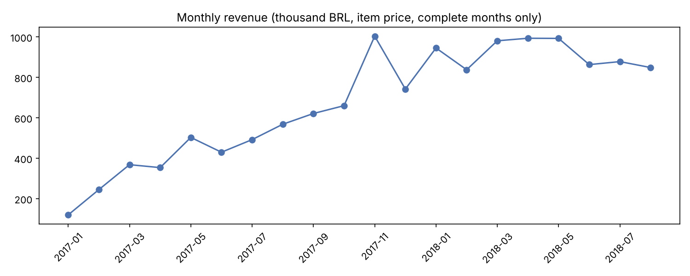
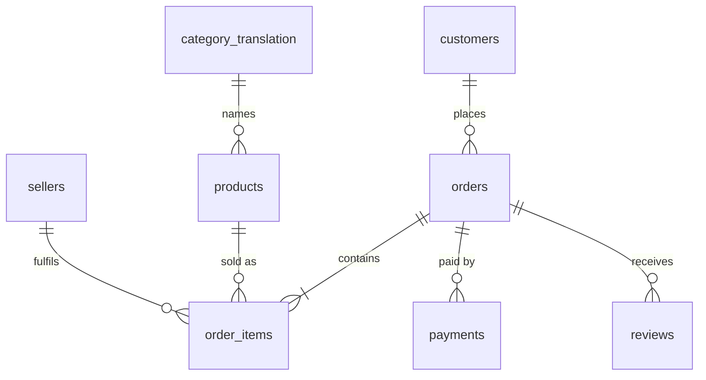

# E-commerce SQL Business Analysis (Olist)

**Business question:** Where does a Brazilian marketplace make its money, where is it losing customers' trust (late deliveries, bad reviews), and how dependent is it on a few sellers?

I answered 18 business questions with SQL only (CTEs, window functions, conditional aggregation) on **99,441 orders, 112,650 order items and 3,095 sellers** across 8 related tables.



## Dataset
[Olist Brazilian E-Commerce Public Dataset](https://www.kaggle.com/datasets/olistbr/brazilian-ecommerce) (Kaggle, 2016-2018). Download the CSVs into `data/` (the geolocation file isn't used). Revenue is in Brazilian reais (BRL).



## How to run
```bash
pip install -r requirements.txt
python load_db.py data olist.db      # builds a SQLite database
python run_queries.py olist.db       # runs sql/*.sql, prints results, saves CSVs to outputs/
python make_charts.py                # README charts
```
(SQLite syntax. For PostgreSQL swap `strftime(...)` for `TO_CHAR/DATE_TRUNC/EXTRACT` and `julianday` differences for date subtraction.)

## Data notes (things that would silently distort results)
- `customer_id` is generated **per order**; real customers are identified by `customer_unique_id`.
- Revenue = item `price` (freight excluded); cancelled/unavailable orders are excluded.
- **Only 2017-01 to 2018-08 are complete months.** 2016 has a handful of orders (none in Nov 2016) and Sep 2018 has 1, so growth queries (Q2, Q11) use only complete months. Without that filter, Q2 reports nonsense like +1,101,719% growth.
- Payment value is per payment *method*, so an order paid partly by voucher and partly by card appears under both (Q5 caveat).

## Questions and findings
| # | Question | Insight |
|---|---|---|
| 1 | Monthly revenue & orders | Revenue grew from ~120K BRL (Jan 2017) to a ~1.0M BRL peak in **Nov 2017** (+52% month-over-month, 7,421 orders), then plateaued at 838K-994K BRL per month in 2018. |
| 2 | Month-over-month growth | Growth is spiky, with the sharpest rise in Nov 2017 followed by -26% in Dec 2017, and flat by spring 2018 (Apr +1.3%, May -0.1%). |
| 3 | Top 10 categories | `health_beauty` (9.3% of revenue), `watches_gifts` (8.9%) and `bed_bath_table` (7.6%) lead; the top 3 are 25.8% of revenue. |
| 4 | Seller concentration | The top 20% of sellers (619 of 3,095) generate **82.7% of revenue**; the bottom 40% generate 1.8%. |
| 5 | AOV by payment type | Credit card 163.94 BRL, boleto 145.03, debit 142.66, voucher 98.15 (voucher is understated, see data notes). |
| 6 | Order status | 97.0% delivered; 0.63% cancelled, 0.61% unavailable. |
| 7 | Delivery vs estimate | Delivered orders take 12.6 days on average vs 23.7 days estimated, i.e. **11.2 days earlier than promised**, so estimates are very conservative. |
| 8 | Late rate by state | 8.1% of delivered orders are late overall; worst are AL (23.9%), MA (19.7%), PI (16.0%), CE (15.3%), SE (15.2%), BA (14.0%), all in the north-east; SP is 5.9%. |
| 9 | Late delivery vs reviews | Late orders average **2.57** stars vs **4.29** on time, and 54.0% of late-order reviews are 1-2 stars vs 9.2% on time. |
| 10 | Repeat customers | Only **3.04%** of customers (2,888 of 94,990) ordered more than once. |
| 11 | Running revenue | Cumulative revenue over the complete months (Jan 2017 to Aug 2018) reaches about 13.4M BRL. |
| 12 | Top sellers per state | Revenue is highly skewed within states too; the top seller in BA made 222,776 BRL against 17,522 for #2. |
| 13 | Top category per state | `bed_bath_table` leads in SP and RS, `watches_gifts` in RJ, PR and DF, `health_beauty` in MG and BA. |
| 14 | Installments by value | Average installments rise from 1.68 (orders under 50 BRL) to 6.82 (400+ BRL). |
| 15 | High-sales, low-review sellers | 20+ above-average sellers average under 4.0 stars; the biggest (1,806 orders, 200K BRL) averages 3.83. |
| 16 | Peak times | Order volume peaks on Mondays and Tuesdays in the afternoon (Tue 14:00 is the busiest slot, 1,124 orders) and Monday 21:00. |
| 17 | Freight share | Freight is 36.7% of price for `christmas_supplies` and 29.1% for `electronics` (2,767 items), i.e. shipping-sensitive categories. |
| 18 | First vs later orders | Later orders are *smaller* (122.74 BRL) than first orders (137.92 BRL), and there are only 3,216 of them vs 94,983 first orders. |

## Top 3 findings
1. **Revenue is concentrated:** 20% of sellers produce 82.7% of revenue, so losing a few top sellers would hurt badly.
2. **Late delivery is the clearest customer-experience problem:** 8% of orders arrive late and those customers rate 2.6 vs 4.3 stars, with the north-east worst affected. This is a correlation, so a late order may also coincide with other problems, but the size of the gap is large.
3. **Olist is an acquisition business:** only 3% of customers ever reorder, and revenue growth flattened through 2018 (see project 03).

## Skills shown
Joins across 5+ tables, CTEs, `LAG`, `NTILE`, `RANK`, `ROW_NUMBER`, running totals, conditional aggregation, and data-model awareness (grain of `customer_id`, partial months).
