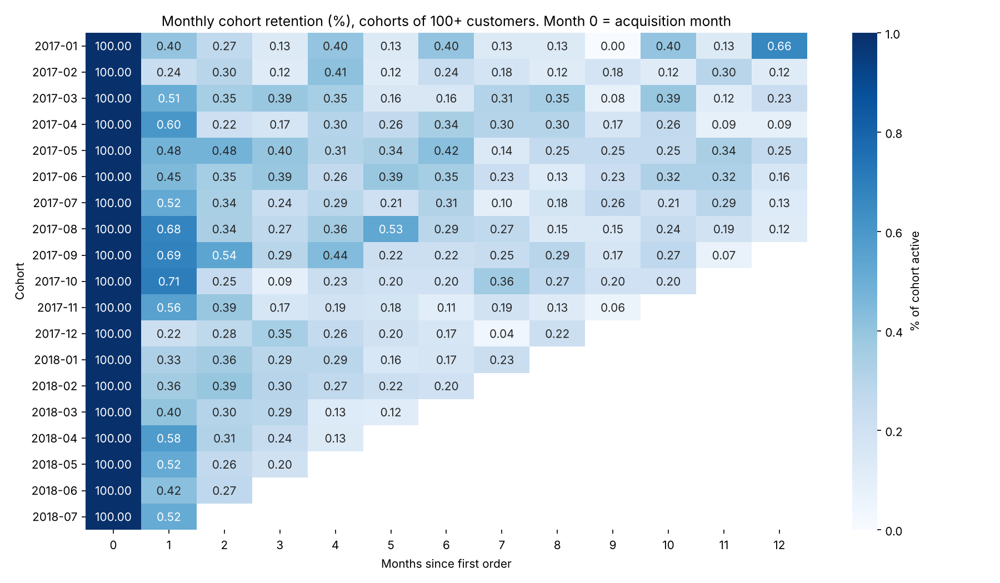

# Cohort Retention, RFM Segmentation & LTV (Olist)

**Business question:** Do customers come back after their first purchase, which customers are most valuable, and what is a customer worth?



## Dataset
Same Olist data as project 01. Build `olist.db` there first (`python load_db.py data olist.db`). Revenue is item price in BRL.

## Approach
- **Cohorts in SQL** (`sql/cohort.sql`): first-order month per `customer_unique_id`, then active customers by months since acquisition.
- **Cohort filtering:** only cohorts from **2017-01 to 2018-07 with 100+ customers**. Earlier cohorts sit next to a gap in the data (almost no orders in Nov-Dec 2016) and the last cohort has no follow-up month; including them gave a wrong month-1 average of 5.2% because one cohort had a single customer.
- **RFM:** recency and monetary in quintiles. Because ~97% of customers bought once, "repeat buyers" are their own segment and one-time buyers are split by recency and spend.
- **LTV:** historical LTV = average order value x orders per customer. It describes the data window; it is **not** a forecast.

## Run
```bash
pip install -r requirements.txt
python src/cohort_rfm.py ../01-olist-sql-analysis/olist.db
```

## Findings
- **Month-1 retention is 0.48%** (19 cohorts, 88,488 customers; individual cohorts range from 0.22% to 0.71%). No cohort exceeds 0.71% in any later month, and most cells are 0.1-0.4%.
- **Repeat-customer rate is 3.04%**, and repeat buyers are only 5.6% of revenue.
- **Orders per customer: 1.034; average order value: 137.42 BRL; historical LTV: 142.07 BRL**, so almost all value comes from the first order.

| Segment | Customers | % of customers | % of revenue | Avg value (BRL) |
|---|---|---|---|---|
| Recent high-value (1 order) | 14,729 | 15.5% | 29.2% | 268 |
| Lapsed high-value (1 order) | 14,002 | 14.7% | 28.8% | 278 |
| Mid-recency (1 order) | 18,386 | 19.4% | 17.8% | 131 |
| Lapsed lower-value (1 order) | 22,956 | 24.2% | 9.5% | 56 |
| Recent lower-value (1 order) | 22,023 | 23.2% | 9.1% | 56 |
| Repeat buyers | 2,887 | 3.0% | 5.6% | 260 |

About **30% of customers (high-value one-time buyers, recent or lapsed) bring 58% of revenue**, and nearly all of them have never come back.

## Recommendation
Olist is acquisition-driven. Test a **second-purchase campaign** (coupon or email 30-60 days after delivery) aimed at recent high-value one-time buyers, and measure it with a holdout A/B test (see project 04) before scaling.

## Limitations
- ~2 years of data, so later cohorts have short follow-up windows.
- Customers who bought once may simply not have needed another purchase (e.g. furniture, appliances); the data can't separate "unhappy" from "no need".
- "Lapsed" here only means a long time since the single purchase.
- Customers are identified by `customer_unique_id`; anyone who ordered under a different account would be counted as two people.
