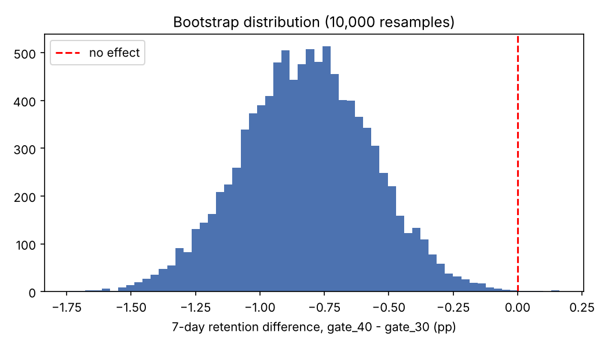

# A/B Test Analysis: Cookie Cats Gate Placement

**Business question:** Should the first progression gate in the mobile game move from level 30 to level 40?



## Dataset
[Cookie Cats](https://www.kaggle.com/datasets/yufengsui/mobile-games-ab-testing-cookie-cats): **90,189 players**, `version` (gate_30 / gate_40), `sum_gamerounds`, `retention_1`, `retention_7`. Save as `data/cookie_cats.csv`.

## Approach
1. **Hypothesis:** H0, moving the gate does not change 7-day retention. H1, it does (two-sided, alpha = 0.05; 0.025 after adjusting for two metrics).
2. **Sanity checks:** sample-ratio-mismatch chi-square on group sizes, outlier check on game rounds.
3. **Test:** two-proportion z-test on 1-day and 7-day retention, with absolute/relative lift and 95% confidence intervals.
4. **Bootstrap:** 10,000 resamples of the 7-day difference as a distribution-free cross-check.
5. **Power:** the smallest lift this sample could detect, and the sample needed for a 0.5 pp effect.

## Run
```bash
pip install -r requirements.txt
python src/ab_test.py
```

## Results
| Metric | gate_30 | gate_40 | Lift (pp) | 95% CI (pp) | p-value |
|---|---|---|---|---|---|
| 1-day retention | 44.82% | 44.23% | -0.59 | [-1.24, +0.06] | 0.074 (not significant) |
| 7-day retention | 19.02% | 18.20% | **-0.82** (-4.3% relative) | [-1.33, -0.31] | **0.0016** |

- **Bootstrap agrees:** mean difference -0.82 pp, 95% interval [-1.32, -0.33] pp, with 99.9% of resamples below zero.
- **Still significant after correcting for two metrics:** p = 0.0016 is well under the Bonferroni-adjusted threshold of 0.025.
- **Power:** with ~44,700 users per group the test could detect a 7-day change of about 0.74 pp (80% power); detecting 0.5 pp would need roughly 96,700 users per group.

## Decision
**Keep the gate at level 30.** Moving it to level 40 lowered 7-day retention by about 0.8 percentage points (19.0% to 18.2%), and the interval excludes zero. The 1-day metric shows no significant change.

## Caveats
- **Group sizes are slightly unbalanced** (44,700 vs 45,489; chi-square p = 0.009). That passes the strict 0.001 alarm level used for sample-ratio checks but is borderline, so in a real experiment I would ask engineering how users were assigned before trusting the result.
- The effect is small in absolute terms (under 1 pp), though in a game with a large player base 0.8 pp is meaningful.
- Retention is a proxy; the data has no revenue or ad-impression information, so a later gate could still pay off commercially.
- Short-term metrics only (1 and 7 days); long-term retention is unknown.
- 91 users sit above the 99.9th percentile of game rounds (one gate_30 user has 49,854 rounds, which looks like a bot or data error). This doesn't affect the retention proportions but would distort average-rounds comparisons. 3,994 users have zero rounds.
