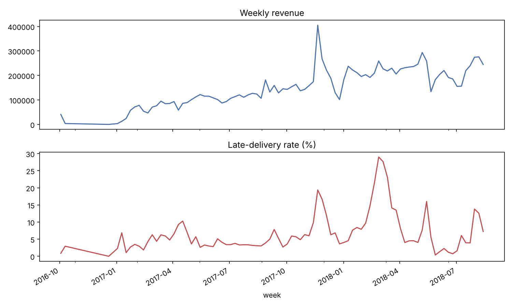

# Weekly KPI report

Latest complete week: **week starting 2018-08-13**

| KPI | Latest week | Week-over-week |
|---|---|---|
| Orders | 1,852 | -5.6% |
| Revenue | 244,675.59 | -11.3% |
| Average order value | 132.11 | |
| Late-delivery rate | 7.23% | |
| Average review score | 4.37 | |

Overall repeat-customer rate: **3.04%**

